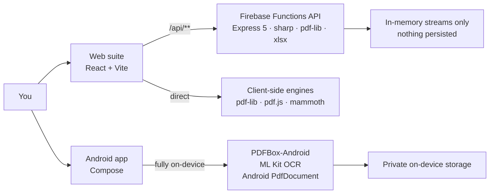

<div align="center">



# DODTH — Document Utility Suite

**Every document, handled.** Convert, merge, compress, protect and sign — on the web and natively on Android, with privacy first.

[](https://react.dev)
[](https://vite.dev)
[](https://firebase.google.com)
[](docs-android/)
[](https://developer.android.com/compose)
[](#license)

</div>

---

## What is this?

DODTH is a professional document toolkit — one product, two experiences:

| | Web suite | Native Android app |
|---|---|---|
| Location | [`frontend/`](frontend/) + [`backend/`](backend/) | [`docs-android/`](docs-android/) |
| Stack | React 19 + Vite 8 · Express 5 on Firebase Functions (Node 20) | Kotlin + Jetpack Compose (Material 3), minSdk 24 |
| Processing | Client-side engines (pdf-lib, pdf.js, mammoth) + secured API | 100% on-device (PDFBox-Android, Android PdfDocument/PdfRenderer, ML Kit OCR) |
| Best for | Big jobs in the browser | Private, offline, mobile-first work |

## Tools

**Convert to PDF** — Word (.docx) → PDF · Excel (.xlsx) → PDF · PowerPoint (.pptx) → PDF · JPG/PNG/WebP/BMP → PDF · HTML → PDF

**Convert from PDF** — PDF → Word · PDF → Excel · PDF → PowerPoint · PDF → JPG · OCR → searchable PDF (Android)

**Organize** — Merge · Split · Rotate · Compress · Page numbers · Remove pages

**Security** — Protect (256-bit AES) · Unlock · Diagonal watermarking

## Architecture



## Quick start

**Web**

```bash
cd frontend
npm install
npm run dev          # http://localhost:5173
npm run build        # production bundle -> frontend/dist
```

**Backend (Firebase Functions)**

```bash
cd backend
npm install
npm run dev          # Express API with --watch
firebase deploy      # hosting (frontend/dist) + functions
```

**Android**

```bash
cd docs-android
gradle wrapper       # first time only (or open in Android Studio)
gradle :app:assembleDebug
```

Requires JDK 17 and Android SDK 35. Full notes: [docs-android/README.md](docs-android/README.md)

## Repository layout

```
├── frontend/          React 19 + Vite 8 web app (Firebase Hosting target)
│   └── capacitor.config.ts   Capacitor shell groundwork (Android)
├── backend/           Express 5 API on Firebase Functions (/api/** rewrites)
├── docs-android/      Native Android edition — 19 tools, offline-first
├── docs/assets/       Brand assets (animated banner)
└── firebase.json      Hosting (frontend/dist) + Functions configuration
```

## Privacy

- **Web** — files are processed in-memory: client-side engines, or API streams that are never written to disk. Uploads (`uploads/`, `outputs/`) are git-ignored.
- **Android** — nothing leaves the phone. No uploads, no accounts, no tracking, no ads.

## Roadmap

- [ ] Visible CI — APK build + web deploy via GitHub Actions
- [ ] Live Editor re-enable (currently hidden from production dashboard)
- [ ] iOS release via the existing Capacitor shell

## License

Proprietary — © 2026 DODTH. All rights reserved. (Backend tooling carries ISC for vendored dependencies.)
